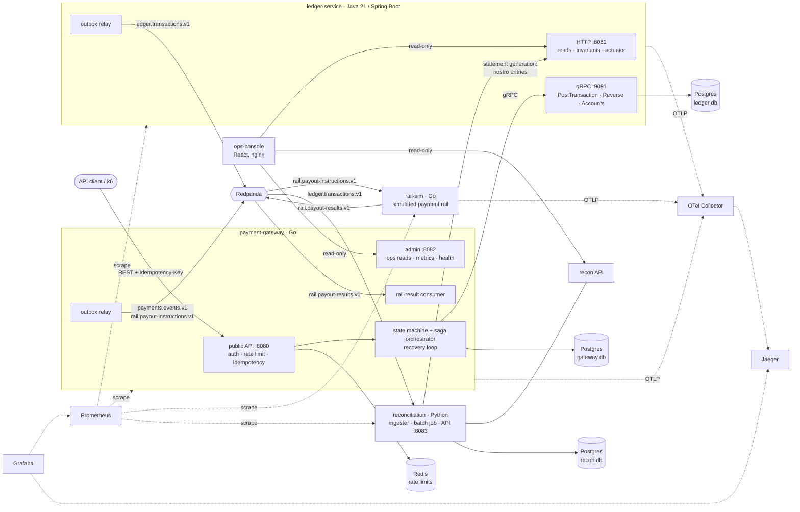
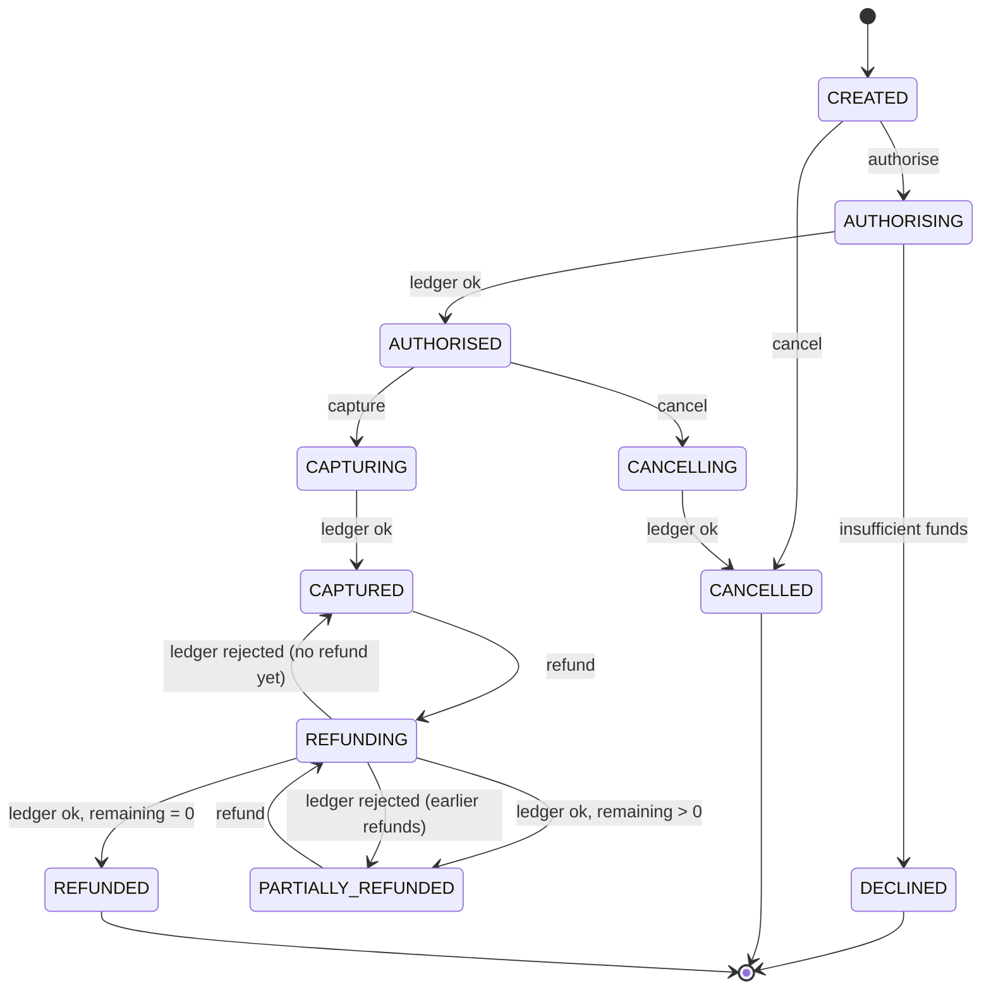
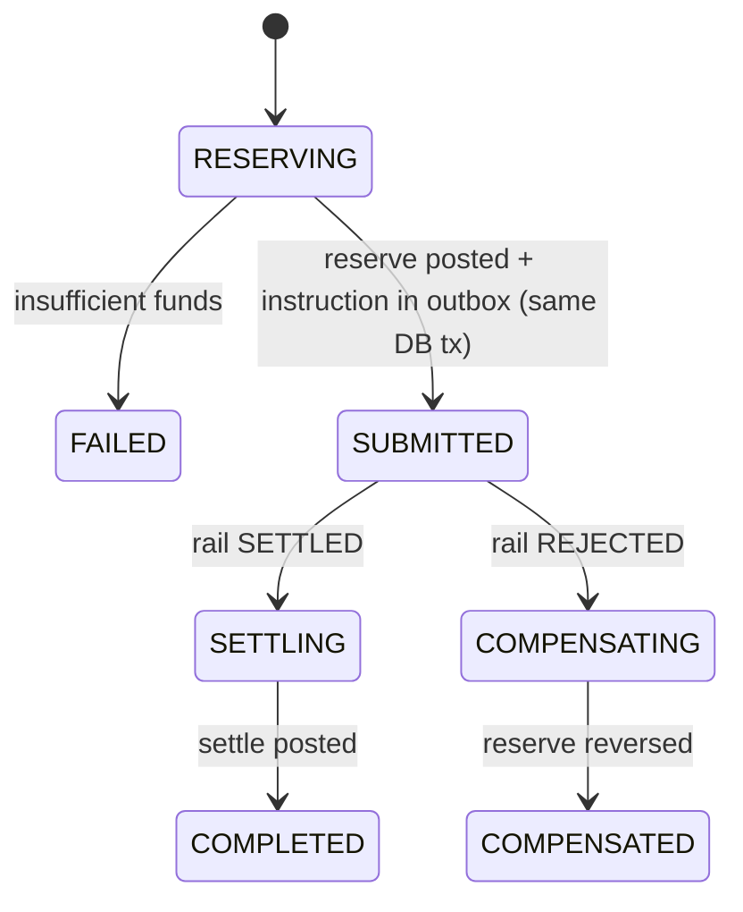

# Meridian — Design

Meridian is a payments platform built on a double-entry ledger. All data is
simulated. There are no real payment rails and no real customer data.

## 1. Requirements

### Functional
| # | Requirement |
|---|-------------|
| F1 | Accounts hold balances in several currencies. Each (account, currency) pair has its own balance and overdraft limit. |
| F2 | Every money movement is a ledger **transaction** made of balanced **postings**, stored in an append-only ledger. |
| F3 | Payment API: create, authorise, capture (full or partial), cancel (void), refund (full or partial). |
| F4 | Transfers: internal (account to account, one atomic ledger transaction) and external payouts (a multi-step saga over a simulated payment rail, compensated when the rail rejects). |
| F5 | Every mutating API call takes an `Idempotency-Key`. Retrying the same request returns the same response and moves money at most once. |
| F6 | Per-client rate limiting on the public API. |
| F7 | Domain events are published through a transactional outbox to Kafka (Redpanda). Consumers are idempotent. |
| F8 | A reconciliation job compares ledger nostro movements and balances with a simulated external bank statement and reports breaks. A generator produces that statement with deliberately injected discrepancies. |
| F9 | A read-only operations console shows payments, transfers, account statements, ledger entries, reconciliation breaks and system health. |

### Non-functional
- Correctness comes before throughput. Every invariant in §2 is enforced in code or in the database, and a test proves it.
- Each service recovers on its own after a crash, a broker outage or database timeouts, and no manual repair is needed.
- Observability: distributed traces across HTTP, gRPC and Kafka; RED metrics; Grafana dashboards; liveness and readiness probes.
- One command starts everything: `docker compose up` (or `make up`).

## 2. Invariants

| ID | Invariant | Primary enforcement | Backstop | Proof |
|----|-----------|---------------------|----------|-------|
| I1 | The postings of every transaction sum to zero, per currency. | Domain validation in `PostingService` before any write. | Deferred constraint trigger `postings_balanced` runs at COMMIT and rejects the transaction. | Unit test, jqwik property test, an integration test that inserts an unbalanced entry with raw SQL and gets rejected. |
| I2 | No balance goes below `-overdraft_limit`, even under concurrent load. | `SELECT … FOR UPDATE` on every touched balance row, taken in a fixed key order (no deadlocks), followed by a limit check. | `CHECK (overdraft_limit IS NULL OR balance >= -overdraft_limit)` on `account_balances`. | Concurrency test (thousands of parallel transfers), property test, k6 run followed by an invariant check. |
| I3 | One idempotency key gives the same result and exactly one financial effect. | Gateway: `idempotency_keys` row (PK client+key, request hash). Ledger: `UNIQUE(idempotency_key)` on transactions, and every ledger key is derived deterministically from (resource id, step). | Unique constraints in both databases. | Gateway rapid property test with random retries and duplicates; ledger concurrent duplicate test; e2e replay test. |
| I4 | Ledger entries are never updated or deleted. Corrections are reversals. | The service has no UPDATE or DELETE code paths. The reversal API creates a new transaction with negated postings. | `BEFORE UPDATE OR DELETE` and `BEFORE TRUNCATE` triggers raise an error. `UNIQUE(reverses_id)` means a transaction can be reversed at most once. | Integration test: UPDATE, DELETE and TRUNCATE all fail. |
| I5 | Every outbox event is delivered at least once and applied once. | The outbox row is written in the same DB transaction as the state change. The relay publishes with an idempotent producer and `acks=all`, and marks a row published only after the broker acks it. Consumers record message ids in an `inbox` (or natural key) table in the same transaction as their effect, and commit Kafka offsets only after that. | Ledger idempotency keys are a second dedup layer. | Broker-stop chaos test; duplicate-delivery unit tests on consumers. |
| I6 | Money is integer minor units with an explicit ISO-4217 currency. Floats are never used. | `bigint` columns, `int64`/`long` types, `CHECK (currency ~ '^[A-Z]{3}$')`, request validation. | The JSON decoder rejects non-integer amounts. | Unit tests on validation. |
| I7 | An account's balance equals the sum of its postings, in its normal-balance sign. | The balance row is updated in the same transaction as the postings, under the row lock. | `GET /api/invariants` recomputes it from the postings. | Asserted after every concurrency, property, chaos and load run. |

## 3. Architecture



Service responsibilities:

- **ledger-service** owns accounts, balances and postings. It is a generic double-entry engine: it knows nothing about payments, and enforces I1, I2, I4, I6 and I7. Writes go through gRPC; reads (for the console and the statement generator) go through HTTP.
- **payment-gateway** owns the payments domain: the public API, idempotency (I3), rate limiting, the payment and transfer state machines, and saga orchestration. It decides *which* postings a business operation produces and sends them to the ledger.
- **rail-sim** stands in for an external payment network (for example SEPA). It consumes payout instructions, dedupes them, waits for a short latency, and then settles or rejects each one with an ISO 20022 reason code.
- **reconciliation** ingests ledger events into its own store (an idempotent consumer), generates simulated bank statements, and runs the reconciliation batch.
- **ops-console** is a read-only SPA served by nginx, which proxies to the three read APIs.

## 4. Accounting model

Postings carry a signed `amount` in minor units: **debit > 0, credit < 0**. A
transaction is balanced when the postings for each currency sum to zero, which
is exactly Σdebits = Σcredits.

Each account has a type, and the type sets its normal balance:
ASSET and EXPENSE are debit-normal; LIABILITY, EQUITY and INCOME are
credit-normal. The stored `balance` uses the account's natural sign
(`balance += amount` for debit-normal accounts, `balance -= amount` for
credit-normal ones), so a customer's EUR balance of 100.00 is stored as `10000`.

System accounts are seeded by migration and hold every supported currency
(EUR, USD, GBP):

| Account | Type | Limit | Purpose |
|---------|------|-------|---------|
| `SYS-NOSTRO` | ASSET | unlimited | Our account at the simulated partner bank. Reconciled against the bank statement. |
| `SYS-AUTH-HOLDS` | LIABILITY | 0 | Funds reserved by payment authorisations. |
| `SYS-PAYOUT-CLEARING` | LIABILITY | 0 | Payouts sent to the rail and not yet settled. |

Customer accounts are LIABILITY accounts (the platform owes the money to the
customer) with a per-currency overdraft limit, 0 by default.

| Operation | Postings (Dr = +, Cr = −) |
|-----------|---------------------------|
| Deposit (inbound funds) | Dr NOSTRO, Cr customer |
| Authorise | Dr payer, Cr AUTH-HOLDS |
| Capture (amount c ≤ a) | Dr AUTH-HOLDS a, Cr payee c, Cr payer (a − c) |
| Cancel (void) | Dr AUTH-HOLDS, Cr payer |
| Refund | Dr payee, Cr payer |
| Internal transfer | Dr source, Cr destination |
| Payout: reserve | Dr source, Cr PAYOUT-CLEARING |
| Payout: settle | Dr PAYOUT-CLEARING, Cr NOSTRO |
| Payout: compensate | Reversal of the reserve transaction |

A capture with a remainder produces a three-leg transaction, and the ledger
accepts any number of legs and currencies as long as each currency nets to
zero.

## 5. Data model

### ledger database
```
accounts(id text PK, name, type, status, created_at)
account_balances(account_id FK, currency char(3), balance bigint, overdraft_limit bigint NULL,
                 version bigint, updated_at,
                 PK(account_id, currency),
                 CHECK (overdraft_limit IS NULL OR balance >= -overdraft_limit))
ledger_transactions(id uuid PK, idempotency_key text UNIQUE, request_hash text, type, description,
                    reverses_id uuid UNIQUE NULL FK, metadata jsonb, booked_at)
postings(id bigserial PK, transaction_id FK, seq int, account_id, currency, amount bigint CHECK (amount <> 0),
         FK(account_id, currency) -> account_balances, UNIQUE(transaction_id, seq))
outbox(id bigserial PK, topic, message_key, event_type, payload jsonb, headers jsonb, created_at, published_at NULL)
```
Triggers: `postings_balanced` (deferred constraint trigger, I1) and
`forbid_mutation` on `ledger_transactions` and `postings` for UPDATE, DELETE and TRUNCATE (I4).

### gateway database
```
payments(id, client_id, payer_account_id, payee_account_id, currency, amount, captured_amount,
         refunded_amount, status, pending_amount, decline_reason, version, created_at, updated_at)
transfers(id, client_id, kind internal|external, source_account_id, destination_account_id NULL,
          beneficiary_iban NULL, beneficiary_name NULL, currency, amount, reference, status,
          reserve_txn_id, settle_txn_id, compensation_txn_id, rail_reference, failure_reason, ...)
deposits(id, client_id, account_id, currency, amount, reference, ledger_txn_id, created_at)
idempotency_keys(client_id, key, request_method, request_path, request_hash, status in_progress|completed,
                 resource_type, resource_id, response_code, response_body, locked_at, created_at,
                 PK(client_id, key))
outbox(id, topic, message_key, event_type, aggregate_type, aggregate_id, payload, headers, created_at, published_at)
inbox(consumer, message_id, processed_at, PK(consumer, message_id))
```

### recon database
```
internal_entries(transaction_id, seq, account_id, currency, amount, booked_at, idempotency_key,
                 PK(transaction_id, seq))                -- idempotent ingest of ledger events
recon_runs(id, business_date, account_id, statement_file, started_at, finished_at,
           matched_count, break_count, totals jsonb)
recon_breaks(id, run_id FK, break_type, currency, reference, ledger_amount, bank_amount, detail)
```

## 6. API contracts

### Public REST API: payment-gateway `:8080`
Every request sends `Authorization: Bearer <api key>`. Every POST also sends
`Idempotency-Key: <1..255 printable chars>`. Amounts are `{"amount_minor": int64, "currency": "EUR"}`.
Errors use RFC 7807 `application/problem+json` with a stable `code`.

| Method & path | Body | Success | Notable errors |
|---------------|------|---------|----------------|
| `POST /v1/accounts` | `{name, currencies:[{currency, overdraft_limit_minor}]}` | 201 account | 400 |
| `GET /v1/accounts/{id}` | | 200 account with balances | 404 |
| `POST /v1/deposits` | `{account_id, amount, reference}` | 201 deposit | 404, 422 |
| `POST /v1/payments` | `{payer_account_id, payee_account_id, amount, description}` | 201 `CREATED` | 400, 422 |
| `POST /v1/payments/{id}/authorise` | | 200 `AUTHORISED` | 402 `DECLINED` (insufficient funds), 409 invalid state |
| `POST /v1/payments/{id}/capture` | `{amount?}` | 200 `CAPTURED` | 409, 422 amount > authorised |
| `POST /v1/payments/{id}/cancel` | | 200 `CANCELLED` | 409 |
| `POST /v1/payments/{id}/refunds` | `{amount}` | 200 `PARTIALLY_REFUNDED` / `REFUNDED` | 409, 422 amount > refundable |
| `GET /v1/payments/{id}` | | 200 | 404 |
| `POST /v1/transfers` | `{source_account_id, destination:{type:"internal",account_id} \| {type:"external",iban,name}, amount, reference}` | 201 `COMPLETED` / 202 `PROCESSING` | 402 `FAILED`, 422 |
| `GET /v1/transfers/{id}` | | 200 | 404 |

Idempotency semantics:
- Same key, same request: the stored response is replayed (`Idempotent-Replayed: true`).
- Same key, different body or path: `422 idempotency_key_reused`.
- Same key while the first request is still running: `409 request_in_progress`. After the lock expires (10 s), the retry re-drives the operation, which is safe because the ledger keys are deterministic.

Rate limit: a token bucket per client in Redis. Exceeding it returns 429 with `Retry-After`.

### Payment state machine

States ending in `-ING` are in-flight. Each one has a single driver function
that calls the ledger with a deterministic idempotency key and then moves to
the resulting state. The HTTP handler calls the driver inline, and a recovery
loop calls it again for any row left in an in-flight state for more than 5 s
(for example after a crash).

### External payout saga

Ledger keys: `transfer:{id}:reserve`, `transfer:{id}:settle`, and reversal key
`transfer:{id}:compensate`. Internal transfers go `RESERVING → COMPLETED | FAILED`
in one ledger transaction (key `transfer:{id}`).

### Ledger gRPC: `ledger.v1.LedgerService` `:9091`
See [`proto/ledger/v1/ledger.proto`](proto/ledger/v1/ledger.proto).
`CreateAccount`, `GetAccount`, `PostTransaction`, `ReverseTransaction`, `GetTransaction`.
Status codes: `INVALID_ARGUMENT` (unbalanced, zero amount, bad currency), `NOT_FOUND`,
`FAILED_PRECONDITION` with an `ErrorInfo` reason of `INSUFFICIENT_FUNDS`, `CURRENCY_NOT_ENABLED` or
`ALREADY_REVERSED`, `ALREADY_EXISTS` (idempotency key reused with a different payload), and
`UNAVAILABLE` / `DEADLINE_EXCEEDED` (retryable).

### Ledger HTTP `:8081` (read-only)
`GET /api/accounts`, `/api/accounts/{id}`, `/api/accounts/{id}/entries?currency=&from=&to=&after=&limit=`,
`/api/transactions?limit=`, `/api/transactions/{id}`, `/api/invariants`, `/actuator/health|prometheus`.
The entry cursor is the previous response's posting id, so the statement simulator can
page through more than 10,000 postings without skipping or repeating a page.

### Reconciliation HTTP `:8083` (read-only)
`GET /api/recon/runs`, `/api/recon/runs/{id}`, `/api/recon/ingestion`,
`/healthz`, `/metrics`. The batch persists every typed break and per-currency opening,
movement and closing totals. The ingester skips malformed events, commits Kafka offsets
only after the valid part of a batch is stored, and remains idempotent on
`(transaction_id, seq)`.

### Events (Kafka)
| Topic | Producer | Key | Consumer |
|-------|----------|-----|----------|
| `ledger.transactions.v1` | ledger outbox | transaction id | reconciliation ingester |
| `payments.events.v1` | gateway outbox | payment or transfer id | (downstream; the outbox table also serves as the audit timeline) |
| `rail.payout-instructions.v1` | gateway outbox | transfer id | rail-sim |
| `rail.payout-results.v1` | rail-sim | transfer id | gateway saga consumer |

Every event carries `event_id` (UUID), `event_type`, `occurred_at`, and W3C `traceparent` in the headers.

## 7. Failure modes

| Failure | What happens | Recovery |
|---------|--------------|----------|
| Client retries (timeout, network) | Same idempotency key → replayed response. | Built in. |
| Gateway crashes after the ledger call, before saving state | Row stays in an in-flight state; idempotency row stays `in_progress`. | Recovery loop re-drives the step after 5 s; the ledger returns the existing transaction for the deterministic key, so there is no double posting. |
| Ledger down or slow | gRPC `UNAVAILABLE` / `DEADLINE_EXCEEDED`; the API returns 503 and the row stays in-flight. | Recovery loop retries with backoff; the client may also retry. |
| Database timeouts (lock or statement) | Ledger transaction rolls back atomically; the gateway sees a retryable error. | Same as above. Postgres `lock_timeout`/`statement_timeout` bound the stall. |
| Broker down | Outbox rows pile up unpublished; payouts wait in `SUBMITTED`. The API keeps accepting work. | The relay retries; when the broker returns, events flow and sagas complete. |
| Duplicate event delivery | The consumer finds the message id in `inbox` (gateway) or the natural key (recon) and skips it. | Built in. |
| Malformed ledger event | Recon counts the poison message, logs the validation failure and skips it without blocking later offsets. | The consumer continues after `recon_events_malformed_total` advances. |
| Rail rejects a payout | Saga compensates by reversing the reserve. | Built in, terminal state `COMPENSATED`. |
| Rail never answers | Transfer stays `SUBMITTED` (that is the truth: it is pending at the rail). | Visible in the console and the `transfers_inflight` metric. |
| Redis down | Rate limiter fails **open** and the error is counted. | Payments keep flowing. |
| Concurrent operations on one payment | The `FOR UPDATE` row lock plus in-flight states make the second request get 409. | Client retries later. |
| Deadlocks between transfers | Balance rows are locked in sorted key order, so lock cycles cannot form. | N/A |
| Bank statement disagrees with the ledger | Recon validates the file shape and reports typed breaks (missing in bank or ledger, amount mismatch, duplicate, balance mismatch), including currencies with historical ledger balance but no movements that day. | Ops investigates; corrections are reversals (I4). |
